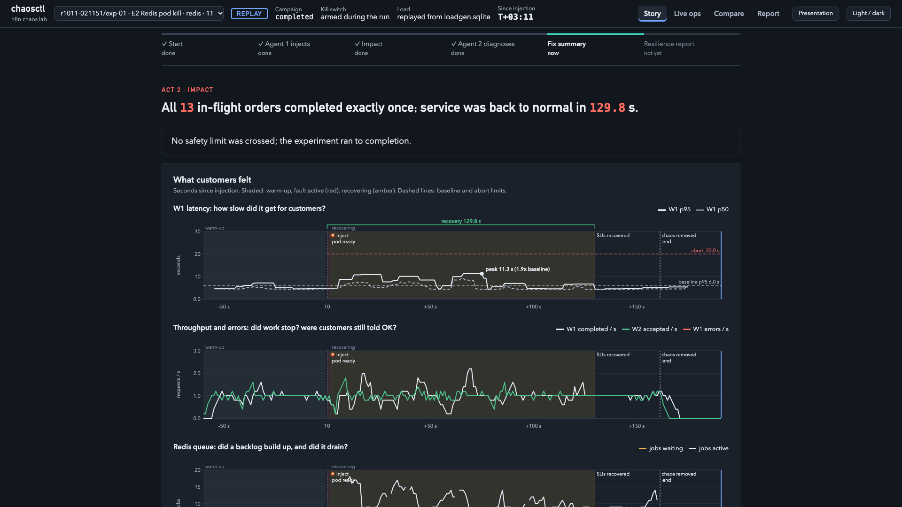

# chaosctl

**AI-driven chaos engineering for cloud-native applications.**

`chaosctl` runs controlled failure experiments against a real multi-service application on Kubernetes. An AI agent
decides *what* to break and *why*, a deterministic safety harness injects the fault and enforces hard limits, and a
second, blind AI agent works out what went wrong from the evidence alone and recommends fixes. Every run ends with a
measured resilience score and a findings report.

The reference target is [n8n](https://n8n.io) (workflow automation) in queue mode: `n8n-main`, `n8n-worker`, Redis,
PostgreSQL and a downstream HTTP API, all running in a local [Kind](https://kind.sigs.k8s.io) cluster with
[Chaos Mesh](https://chaos-mesh.org).



---

## Table of contents

- [Features](#features)
- [How it works](#how-it-works)
- [Architecture](#architecture)
- [Requirements](#requirements)
- [Installation](#installation)
- [Usage](#usage)
- [Deployment and containerization](#deployment-and-containerization)
- [Configuration](#configuration)
- [Safety model](#safety-model)
- [Fault catalog](#fault-catalog)
- [Project structure](#project-structure)
- [Testing](#testing)
- [Documentation](#documentation)
- [Third-party components](#third-party-components)

---

## Features

- **Dependency mapping.** Discovers services from the Kubernetes API, merges declared dependencies, and computes
  blast radius, single points of failure and criticality. Exports to JSON and Mermaid.
- **Agent 1: experiment planner.** Scores every allowed experiment, lets an LLM pick one with a cited hypothesis,
  validates the answer, and runs it through a policy guard. The LLM never runs commands or writes YAML.
- **Safe fault injection.** 11 enabled faults covering six failure classes (crashes, network faults, full disk,
  database overload, failed dependencies, traffic spikes), driven by Chaos Mesh, allow-listed Kubernetes Jobs and a
  built-in load generator.
- **Customer-side measurement.** A load generator sends real orders and records every request; a *fate table* classifies
  each in-flight request as completed, lost silently, lost with an error, duplicated or phantom success.
- **Agent 2: blind diagnosis.** Never told what was injected. Investigates with read-only tools (pods, events, logs,
  queue, database, client metrics), explains its reasoning, and recommends fixes from a vetted playbook only. Graded
  afterwards against the ground truth.
- **Resilience score and findings report.** Formula-based score (availability, self-recovery, latency, data integrity,
  detectability) plus an AI-written, fact-checked findings report in Markdown and JSON.
- **Live dashboard.** Real-time charts, pod swimlanes, agent transcripts, a run-by-run story view, run comparison,
  replay of recorded runs, and a cited RAG chat ("Ask Agent 2"). Works fully offline.
- **Graceful degradation.** Every LLM call is cached, rate-limited and has a deterministic fallback. Fallbacks are
  always surfaced loudly, never hidden.

## How it works

Each experiment injects exactly one fault, exactly once:

1. **Plan.** Agent 1 ranks catalog experiments (`0.4·criticality + 0.3·untested + 0.2·new-info − 0.1·risk`), the LLM
   picks one and states a hypothesis, and the policy guard approves it and sets abort limits.
2. **Pre-flight.** Correct cluster, all pods ready, no leftover chaos, baseline present, kill switch clear.
3. **Warm-up and in-flight gate.** Steady load until the system is healthy, then wait until real work is in flight.
4. **Inject.** One Chaos Mesh resource or Job, built from a catalog template and verified to have taken effect.
5. **Observe.** A 1 Hz safety controller watches error rate, p95 latency, queue depth, collateral damage and the kill
   switch, and stops the experiment if any limit is crossed.
6. **Recover.** Chaos is removed; a watchdog waits for every pod to be ready and restarts workloads if needed.
7. **Account.** Every in-flight request is classified from database row counts; an evidence bundle is written.
8. **Diagnose and report.** Agent 2 diagnoses blind, a fix summary is generated, and the run is scored.

## Architecture

```
┌──────────────────────────── chaosctl (Python, runs on the host) ─────────────────────────────┐
│  dependency graph ─► Agent 1 (score ► LLM picks ► validate ► policy guard)                     │
│     ─► in-flight gate ─► inject (Chaos Mesh / Jobs / load) ─► observe ─► recover              │
│     ─► fate table + evidence ─► Agent 2 (blind diagnosis) ─► score + findings report          │
│  safety controller (1 Hz) · kill switch · audit journal · dashboard (:8787) + RAG chat        │
└─────────────┬─────────────────────────────┬─────────────────────────────┬────────────────────┘
              │ Kubernetes API              │ Redis / Postgres probes     │ load generator
              ▼                             ▼ (NodePorts on 127.0.0.1)    ▼ (2 orders/s)
┌──────────────────────────── Kind cluster "chaos" (Docker) ──────────────────────────────────┐
│  chaos-mesh : Chaos Mesh controller + daemon (acts only on annotated namespaces)            │
│  monitoring : kube-prometheus-stack (optional)                                              │
│  n8n-chaos  : n8n-main ─► redis ─► n8n-worker ×2 ─► mock-api                                │
│                   └────────────► postgres ◄────────┘                                        │
└─────────────────────────────────────────────────────────────────────────────────────────────┘
LLM: Mistral API. Receives graph summaries, plan metadata and redacted evidence only.
```

**Tech stack:** Python 3.12+, LangGraph, Typer, httpx, Kubernetes Python client, Chaos Mesh 2.8, Kind, Helm,
n8n 2.42, Redis 7.4, PostgreSQL 17, Mistral API (`ministral-14b-latest`, fallback `ministral-8b-latest`).

## Requirements

| Requirement | Notes |
|---|---|
| Linux or macOS | 8 GB RAM minimum; give Docker at least 6 GB |
| [Docker](https://docs.docker.com/get-docker/) | Docker Engine or Docker Desktop |
| [kind](https://kind.sigs.k8s.io/) | tested with v0.33 |
| [kubectl](https://kubernetes.io/docs/tasks/tools/) | |
| [Helm](https://helm.sh/) | v3.12+ or v4 |
| [uv](https://docs.astral.sh/uv/) | Python package and environment manager |
| Mistral API key | optional; without it every AI step uses its deterministic fallback |

On macOS: `brew install kind kubectl helm uv`. First-time setup takes about 25 minutes, mostly image pulls.

## Installation

### 1. Clone and install the Python package

```bash
git clone https://github.com/fall-of-aeon/chaosctl.git
cd chaosctl
uv sync
cp .env.example .env    # then set MISTRAL_API_KEY (optional)
```

Verify the install (no cluster required):

```bash
uv run pytest
```

### 2. Create the cluster

Creates the Kind cluster `chaos`, installs Chaos Mesh and kube-prometheus-stack, and creates the annotated
`n8n-chaos` namespace (10–15 min):

> **Linux hosts:** load the kernel loop module *before* creating the cluster. The full-disk fault puts Postgres on a
> small loop-mounted volume inside the Kind node, which needs `/dev/loopN` devices (Docker Desktop provides them
> already). If the cluster already exists, delete and recreate it after loading the module.
>
> ```bash
> sudo modprobe loop
> ```

```bash
uv run chaosctl cluster-up
```

### 3. Deploy the target application

Generates local secrets into `state/secrets.env`, builds the mock API image, loads all images into Kind, and deploys
PostgreSQL, Redis, the mock API and n8n in queue mode (5–10 min):

```bash
uv run chaosctl up
```

Use `uv run chaosctl up --profile hardened` to deploy Redis with persistence (AOF + PVC) for before/after comparisons.

### 4. Import and publish the workflows

```bash
uv run chaosctl bootstrap
```

### 5. Tune the cluster for experiments

Run two workers, and scale monitoring down to free CPU (the dashboard does not need it):

```bash
kubectl -n n8n-chaos scale deploy/n8n-worker --replicas=2
```

```bash
kubectl -n monitoring scale deploy/monitoring-grafana --replicas=0
```

```bash
kubectl -n monitoring patch prometheus monitoring-kube-prometheus-prometheus --type merge -p '{"spec":{"replicas":0}}'
```

### 6. Capture a baseline

```bash
uv run chaosctl baseline --duration 120
```

Expected: 100 % success, p95 around 4–6 s, queue near 0. The n8n UI is at http://127.0.0.1:15678.

## Usage

Start the dashboard in its own terminal and open http://127.0.0.1:8787:

```bash
uv run chaosctl dashboard
```

Run a complete, AI-driven experiment (Agent 1 plans, the harness injects, Agent 2 diagnoses):

```bash
uv run chaosctl demo
```

### Command reference

| Command | Description |
|---|---|
| `chaosctl graph` | Print the dependency map; writes `graph.json` and `graph.mmd` |
| `chaosctl plan --dry-run` | Show Agent 1's plan, reasons and guard verdicts without injecting |
| `chaosctl demo` | Plan, run and diagnose one experiment end to end |
| `chaosctl run --exp E1` | Run a specific fault by alias or catalog id (repeatable) |
| `chaosctl diagnose` | Run Agent 2 on the newest run (`--run <id>` for a specific one) |
| `chaosctl report` | Generate the scored findings report (`--run <id>`, `--all`) |
| `chaosctl eval` | Agent scoreboard from recorded runs → `reports/eval.md` |
| `chaosctl kb` | List the fault knowledge base and run a consistency check |
| `chaosctl dashboard --replay <run-id>` | Replay a recorded run without a cluster |
| `chaosctl kill` | Kill switch: stop load, delete all chaos, wait for recovery |
| `chaosctl recover --ack` | Clean up after a crash and clear the LOCKED state |
| `chaosctl down` / `cluster-down` | Remove the application / delete the cluster |

Add `--require-llm` before any command to fail instead of falling back when the LLM is unavailable. Run
`uv run chaosctl --help` for all options.

Each experiment takes 2–4 minutes. Output is written to `reports/<run-id>/` (journal, evidence, diagnosis, findings).

## Deployment and containerization

**What runs in containers.** The entire system under test is containerized and deployed to Kubernetes:

| Component | Image | Deployed by |
|---|---|---|
| n8n main + workers | `docker.n8n.io/n8nio/n8n:2.42.4` | Helm chart `n8n-helm-chart` 1.15.0 (`helm-values/`) |
| PostgreSQL | `postgres:17.6-alpine` | `k8s/postgres.yaml` (StatefulSet) |
| Redis | `redis:7.4.5-alpine` | `k8s/redis.yaml` or `k8s/redis-hardened.yaml` |
| Mock downstream API | `chaosctl/mock-api:0.1.0`, built from [`mock_api/Dockerfile`](mock_api/Dockerfile) | `k8s/mock-api.yaml` |
| Chaos Mesh | upstream chart 2.8.4 | `scripts/cluster-up.sh` |
| Prometheus / Grafana | kube-prometheus-stack 92.3.0 | `scripts/cluster-up.sh` |

Images are built locally and streamed directly into the Kind node's containerd, so no registry is needed.

**What runs on the host.** The `chaosctl` controller (CLI, agents, safety controller, load generator and dashboard) is
a Python package that runs on the host machine, not in a container. This is deliberate: the kill switch and recovery
watchdog must keep working even if the cluster is degraded, and the load generator measures the system from outside,
the way a customer would.

**Deployment target.** The supported deployment is a local, single-node Kind cluster, created and torn down with
one command each:

```bash
uv run chaosctl cluster-up && uv run chaosctl up && uv run chaosctl bootstrap
```

```bash
uv run chaosctl cluster-down
```

As a safety measure, the harness refuses to act on any kube context other than the one in `CHAOSCTL_KUBE_CONTEXT`
(default `kind-chaos`), and Chaos Mesh is restricted to the annotated `n8n-chaos` namespace. Pointing `chaosctl` at a
shared or production cluster is not supported.

## Configuration

Environment variables (`.env`):

| Variable | Default | Description |
|---|---|---|
| `MISTRAL_API_KEY` | – | Mistral API key; leave empty to use deterministic fallbacks |
| `MISTRAL_MODEL` | `ministral-14b-latest` | Primary model |
| `MISTRAL_FALLBACK_MODEL` | `ministral-8b-latest` | Model used after repeated failures |
| `CHAOSCTL_LLM_BUDGET` | `30` | Maximum LLM calls per campaign |
| `CHAOSCTL_KUBE_CONTEXT` | `kind-chaos` | The only kube context the harness will use |
| `CHAOSCTL_REQUIRE_LLM` | unset | Set to `1` to fail instead of falling back |

Behaviour is defined in YAML under [`chaosctl/`](chaosctl):

| File | Purpose |
|---|---|
| `catalog.yaml` | The only faults that may be injected: templates, targets, intensity ladders, risk tiers |
| `policy.yaml` | Abort limits, tier rules, warm-up, in-flight gate, recovery deadlines |
| `playbook.yaml` | The only fixes Agent 2 may recommend, with verification and rollback steps |
| `overlay.yaml` | Declared dependencies and data flows not visible in manifests |
| `scoring.yaml` | Resilience score component weights |
| `knowledge/*.yaml` | Per-fault hypothesis, expected symptoms and signatures |

## Safety model

Safety is enforced by deterministic code. AI can only make limits stricter, never looser.

- **Scoped.** Chaos Mesh acts only on the annotated `n8n-chaos` namespace; every resource uses `mode: one` and a
  capped duration; Jobs run only allow-listed images without privileges or host access.
- **Catalog only.** Agents choose `(fault, target, intensity)` from the catalog. They never produce YAML or commands.
- **Risk tiers.** High-risk faults (Redis, Postgres, n8n-main) are only allowed after a low-risk experiment has passed.
- **Automatic stop.** A 1 Hz controller aborts on error rate, latency, queue depth, collateral damage or time limit.
- **Kill switch, three ways:** `chaosctl kill`, creating a `KILL` file in the repo root, or Ctrl-C / SIGTERM.
- **Recovery watchdog.** Restarts workloads that do not recover and locks the system if that fails.
- **Audit trail.** Every decision and action is appended to `reports/<run-id>/journal.jsonl`.
- **Read-only diagnosis.** Agent 2 never changes the system; fixes are advisory.

## Fault catalog

| Failure class | Example faults | Mechanism |
|---|---|---|
| Service / container crash | worker, n8n-main, Redis, Postgres pod kill; worker pod failure | Chaos Mesh `PodChaos` |
| Network fault | worker ↔ Redis partition | Chaos Mesh `NetworkChaos` |
| Failed dependency | mock API HTTP 500/503, added latency | Chaos Mesh `HTTPChaos` |
| Full disk | fill Postgres's (isolated 512 MiB) volume | Kubernetes Job |
| Database overload | `pgbench` clients, connection exhaustion | Kubernetes Job |
| Traffic spike | 2 → 6 or 10 requests/s | Built-in load generator |

11 faults are enabled by default; others are present but disabled (`enabled: false`). Full details in
[`chaosctl/catalog.yaml`](chaosctl/catalog.yaml) and [docs/KNOWLEDGE_BASE.md](docs/KNOWLEDGE_BASE.md).

## Project structure

```
chaosctl/            Python package
  cli.py             command-line interface
  graph.py           dependency graph, blast radius, SPOF detection
  agents/            Agent 1 (injection), campaign loop, Agent 2 (diagnosis, investigator, reporter)
  chaos/             Chaos Mesh client (catalog templates only)
  runner.py          single experiment lifecycle
  safety.py          safety controller, kill switch, recovery watchdog
  loadgen.py         load generator and request log
  probes.py          Redis / Postgres / Kubernetes probes, fate classification
  llm.py             LLM client: caching, retries, fallback, budget, redaction
  score.py           resilience score
  rag.py             cited chat over run records
  dash/              dashboard server and static web UI
k8s/                 Kubernetes manifests for the target stack
helm-values/         Helm values for n8n, Chaos Mesh, kube-prometheus-stack
mock_api/            mock downstream service (FastAPI, Dockerfile)
workflows/           n8n workflows (sync and async order flows)
scripts/             cluster and application lifecycle scripts
tests/               pytest suite with recorded fixtures
docs/                guides, results and screenshots
```

## Testing

```bash
uv run pytest
```

The unit test suite (276 tests) needs no cluster or API key. Live end-to-end results, including every number
measured on a cluster rebuilt from scratch, are in [docs/E2E_RESULTS.md](docs/E2E_RESULTS.md).

## Documentation

| Document | Contents |
|---|---|
| [docs/TEAM_HANDBOOK.md](docs/TEAM_HANDBOOK.md) | In-depth internals, build log, findings and troubleshooting |
| [docs/DEMO.md](docs/DEMO.md) | Demo runbook |
| [docs/KNOWLEDGE_BASE.md](docs/KNOWLEDGE_BASE.md) | Fault knowledge base, report and scoring design |
| [docs/E2E_RESULTS.md](docs/E2E_RESULTS.md) | End-to-end test results |
| [docs/FACTS.md](docs/FACTS.md) | Verified technical facts |
| [docs/PROGRESS.md](docs/PROGRESS.md) | Detailed development log |

## Third-party components

| Component | License |
|---|---|
| n8n (target application) | Sustainable Use License |
| Chaos Mesh, Kind, Prometheus | Apache-2.0 |
| Grafana | AGPL-3.0 |
| LangGraph | MIT |
| Redis 7.4 | RSALv2 / SSPLv1 |
| PostgreSQL | PostgreSQL License |
| FastAPI, pydantic, Typer, httpx, Rich | MIT / BSD |
| Mistral API | Mistral AI terms of use |

All data is synthetic, generated by the built-in load generator. Only graph summaries, plan metadata and redacted
evidence summaries are sent to the LLM.

---

Built for the Bosch Hackathon *AI-Driven Chaos Engineering for Cloud-Native Resilience*.
