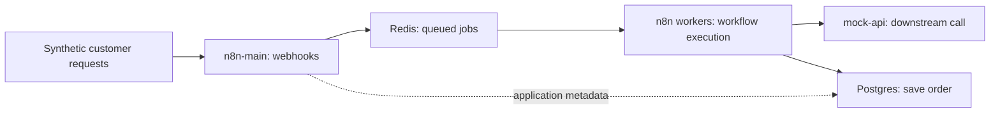
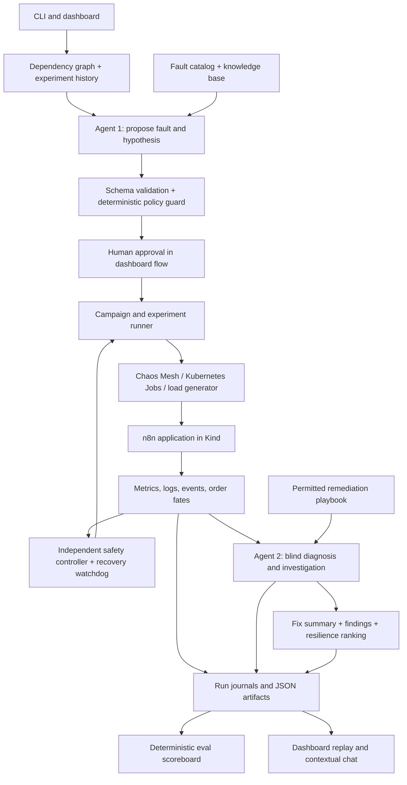

# chaosctl — AI-Driven Chaos Engineering for Cloud-Native Resilience

**Project documentation and presentation source**  
**Documentation date:** 11 October 2026  
**Code baseline reviewed:** `232bf55` plus formula-scoring and dashboard-scroll updates, branch `eval-scoreboard`  
**Project:** `chaos-n8n`, CLI: `chaosctl`

> We deliberately introduce failures into a real workflow platform, measure what happens to customer requests, and use AI to select experiments and diagnose incidents. A deterministic controller enforces safety, while recorded evidence makes the results reviewable.

This document covers the implemented system, its evidence, and its limitations. Sections 1–15 provide presentation content; the remaining sections provide technical reference and speaker preparation. Results are dated observations on the local testbed, rather than guarantees for other environments.

## 1. Executive summary

`chaosctl` is a Python tool for controlled resilience experiments on **n8n running in Kubernetes**. It combines dependency discovery, AI experiment planning, fault injection, automatic rollback, customer-level measurements, blind diagnosis, and findings reports.

The project was built for the Bosch Hackathon challenge, **AI-Driven Chaos Engineering for Cloud-Native Resilience**.

The central question is:

**When infrastructure fails, does the application still deliver the outcome promised to the customer?**

The project answers that question by reconciling each request with its database outcome. A service can recover, a pod can remain green, and an asynchronous client can receive `200 OK`, while an accepted order is still lost.

### What the system delivers

| Capability | Delivered behavior |
|---|---|
| Understand the application | Discover Kubernetes services and dependencies, enrich them with declared business flows, and calculate blast radius and criticality |
| Plan experiments | Agent 1 proposes permitted faults, reasons, hypotheses, and graph citations |
| Execute safely | Validate the plan, apply runtime guards, verify injection, monitor limits, remove faults, and check recovery |
| Measure customer impact | Track errors, latency, queue behavior, readiness, restarts, and the fate of in-flight orders |
| Diagnose incidents | Agent 2 investigates without receiving the injected fault identity |
| Explain and prioritize | Produce playbook-based fixes, findings, and resilience rankings |
| Present and audit | Live dashboard, recorded-run replay, contextual chat, and deterministic agent evaluation |

## 2. The problem and motivation

Distributed applications depend on queues, databases, workers, and external services. A small failure can cascade through those dependencies. Conventional monitoring often reports whether processes are running, while customers care whether their work completed correctly.

Examples explored by this project:

- A worker restarts and the system looks healthy, but an accepted asynchronous order disappears.
- Redis returns quickly, but its restart causes the application and workers to restart too.
- A customer receives an error even though the database saved the order, making a retry potentially dangerous.
- A slow downstream API also disrupts its readiness probe, causing a wider outage than the intended delay.

Chaos engineering tests these assumptions through controlled experiments. AI helps choose useful experiments and interpret evidence; explicit policies keep execution bounded.

## 3. Objectives and scope

### Project objectives

1. Run a real multi-service application in a local Kubernetes sandbox.
2. Map services, dependencies, and business workflows.
3. Let AI select meaningful experiments from a permitted catalog.
4. Enforce deterministic limits, kill switches, and recovery checks.
5. Measure visible failures and silent data-integrity failures.
6. Diagnose causes from evidence without revealing the injection.
7. Generate actionable findings and reproducible evaluation results.

### Current scope

The implemented testbed is a **single-node Kind cluster** named `chaos`, using the Kubernetes context `kind-chaos` and application namespace `n8n-chaos`. Traffic consists of synthetic orders.

The project demonstrates a reusable orchestration pattern through an n8n-specific implementation. Workflows, probes, knowledge files, and policies encode assumptions about this testbed. Supporting another application would require adapting those parts.

## 4. System under test: n8n in queue mode

n8n is a workflow automation platform with source-available licensing. In this project, queue mode separates request acceptance from workflow execution.

| Component | Responsibility | Why a failure matters |
|---|---|---|
| `n8n-main` | Receives webhooks, queues executions, and serves the application UI | Failure interrupts request acceptance |
| Redis | Coordinates queued work between main and workers | Failure can disrupt dispatch and trigger application restarts |
| `n8n-worker` | Executes workflow steps | Failure can interrupt work already accepted |
| Postgres | Stores application data and the experiment's `orders` table | Failure can prevent or obscure successful persistence |
| `mock-api` | Simulates a downstream service with a normal delay of about four seconds | Failure exposes dependency and timeout behavior |
| Load generator | Sends synthetic requests and records client responses | Provides customer-facing measurements |

The E2E campaign described later used **two workers**. Earlier experiments also used a one-worker configuration; their numbers should not be mixed with the two-worker results.

### Application flow



This is a conceptual execution flow. The dependency graph also includes direct Redis and Postgres connections from n8n services.

## 5. Two workflows reveal two kinds of customer impact

Both workflows receive an order, call the mock API, and save the order in Postgres. Their response timing differs.

| Workflow | Response timing | Failure visibility |
|---|---|---|
| **W1 — synchronous order** | Responds after workflow processing | Customers experience latency, errors, or inconsistent completion |
| **W2 — asynchronous order** | Acknowledges immediately, before processing finishes | Customers can receive success while work is later lost |

Normal steady traffic is **two requests per second**, split between W1 and W2. Every request has a unique `request_id`.

After an experiment, the harness compares the client response with matching rows in Postgres. This reconciliation is the foundation of the project's data-integrity measurements.

### Order-fate classification

| Recorded fate | Meaning |
|---|---|
| `completed_once` | Client received success and exactly one order row exists |
| `lost_silently` | W2 client received success, but no order row exists |
| `lost_visible` | Client received an error and no order row exists |
| `duplicated` | More than one matching order row exists |
| `phantom_success` | Client received an error, but the order was saved |
| `success_without_row` | W1 client received success, but no order row exists |

These are measured outcomes, not inferred root causes. A missing order proves an integrity problem; it does not by itself prove the internal mechanism that caused it.

## 6. Overall architecture



The diagram depicts the dashboard approval flow. CLI campaigns use their command options and execution path; human approval is not a universal gate for every CLI invocation.

### Technology stack

| Layer | Technology and purpose |
|---|---|
| Application | n8n queue mode, Redis, Postgres, mock API |
| Local infrastructure | Docker, Kind, Kubernetes, Helm |
| Fault injection | Chaos Mesh, scoped Kubernetes Jobs, load-generator controls |
| Agent orchestration | LangGraph state graphs |
| Model integration | Mistral API with structured JSON output |
| Validation | Pydantic schemas and application-specific validators |
| Harness | Python 3.12+, Kubernetes client, Redis client, psycopg, httpx |
| CLI | Typer and Rich |
| Dashboard | Local Python server, browser JavaScript, SVG charts |
| Persistence | JSON, JSONL, YAML configuration, SQLite client records and LLM cache |
| Infrastructure monitoring | Prometheus and Grafana are installed by cluster setup; core experiment measurements also use direct probes and recorded client data |
| Verification | pytest unit tests and documented live E2E acceptance runs |

Mistral models configured in the documented runs are `ministral-14b-latest`, with `ministral-8b-latest` as a fallback model. The optimized live investigator uses an 8B model by default for tool selection and conclusion, configurable through environment variables.

## 7. Dependency discovery and experiment prioritization

`chaosctl graph` combines Kubernetes manifests and configuration with a declared overlay in `chaosctl/overlay.yaml`.

It creates stable node, edge, and workflow identifiers, maps dependencies, and derives blast radius, single points of failure, and criticality. The overlay supplies business relationships that infrastructure discovery alone cannot establish.

Agent 1 receives candidate experiments ranked by a deterministic prior:

```text
candidate score = 0.4 × criticality
                + 0.3 × untested
                + 0.2 × information gain
                − 0.1 × tier risk
```

This score prioritizes important, unexplored experiments while penalizing higher risk. It is an input to AI planning, rather than proof that the selected fault is globally optimal.

## 8. Agent 1: AI experiment planner

### Inputs

- Dependency graph and stable identifiers.
- Enabled fault, target, and severity-rung combinations.
- Experiment history.
- Safety policy and fault knowledge.

### Outputs

- Selected fault, target, and permitted rung.
- Explanation citing graph identifiers.
- A testable hypothesis.
- Timing and cooldown information.

### Validation and execution boundary

The planner uses structured output constrained by the allowed candidates. Validators reject unknown citations, unsupported combinations, and duplicate planned faults. A self-correction attempt can use validation feedback; invalid output can result in a labelled deterministic fallback.

The policy guard orders experiments by risk and restricts thresholds. Runtime guards recheck eligibility immediately before execution. Tier-3 experiments require a previously passed tier-1 experiment.

On the dashboard, users inspect the proposal and press **Approve and inject**. The approved plan executes through the campaign runner, runtime guard, preflight checks, and safety controller.

## 9. Experiment lifecycle and deterministic safety

### Experiment sequence

1. Load the graph, catalog, policy, and history.
2. Generate and validate a plan.
3. Check context, namespace, system readiness, and fault prerequisites.
4. Warm up steady traffic for 60 seconds.
5. Wait for at least three requests in flight, with a 90-second wait timeout.
6. Record the in-flight requests, inject the fault, and verify it took effect.
7. Observe metrics and enforce safety limits.
8. Remove managed faults and check service recovery.
9. Reconcile request outcomes and write evidence.
10. Update history, diagnose, and report.

An experiment whose injection cannot be verified is marked `inject_failed`, rather than treated as a successful resilience test.

### Safety controls

| Control | Implemented behavior |
|---|---|
| Cluster restriction | Refuse the wrong Kubernetes context |
| Namespace restriction | Constrain managed faults to `n8n-chaos`; Chaos Mesh namespace filtering is enabled |
| Fault allowlist | Validate rendered resources against catalog restrictions |
| Bounded targeting | Chaos Mesh primary selectors use `mode: one`; dependency-target selectors have separately validated rules |
| Threshold enforcement | Monitor customer errors, latency, queue size, duration, and unexpected unready workloads |
| Independent monitoring | Safety controller runs in a separate thread, normally once per second |
| Kill switch | CLI command, `KILL` file, and interrupt handling |
| Rollback | Remove managed faults and restore modified experiment conditions |
| Recovery watchdog | Wait for healthy services; attempt workload restarts when recovery exceeds the deadline |
| Failed recovery | Record failure and enter a locked state that blocks further experiments |

### Default policy values

| Parameter | Value |
|---|---|
| W1 error-rate abort limit | 50% |
| W1 p95 latency abort limit | 20,000 ms |
| Queue-waiting abort limit | 500 jobs |
| Experiment maximum duration | Normally 180 seconds |
| Reversible tier-2 fault duration cap | 60 seconds |
| Recovery deadline | 120 seconds for worker/Redis faults; 150 seconds for main/Postgres pod kills |
| Fate reconciliation wait | 180 seconds |

Tier-specific rules modify arming and expected-impact handling. Tier 1 has a 90-second error/latency arming window; tier 3 disables the error-rate abort because an outage is expected. Queue limits, timing, and other applicable safeguards still govern the experiment.

For an automatic-stop demonstration, `--queue-abort 20` tightens the queue limit.

## 10. Enabled fault catalog

The reviewed catalog has **11 enabled faults** spanning crashes, latency, storage pressure, database overload, dependency failure, and traffic spikes.

| Fault | Target | Injection method | Tier |
|---|---|---|---|
| `worker_pod_kill` | Worker | PodChaos pod kill | 1 |
| `worker_pod_failure` | Worker | PodChaos pod failure | 1 |
| `mockapi_http_500` | Mock API | HTTPChaos response replacement | 1 |
| `mockapi_latency` | Mock API | HTTPChaos delay | 2 |
| `postgres_overload` | Postgres | Kubernetes Job using pgbench | 2 |
| `traffic_spike` | Webhook traffic | Load-generator rate increase | 2 |
| `worker_redis_partition` | Worker–Redis connection | NetworkChaos partition | 2 |
| `redis_pod_kill` | Redis | PodChaos pod kill | 3 |
| `main_pod_kill` | n8n main | PodChaos pod kill | 3 |
| `postgres_pod_kill` | Postgres | PodChaos pod kill | 3 |
| `postgres_disk_full` | Postgres volume | Kubernetes Job writing a ballast file | 3 |

Each fault can have predefined severity rungs. The catalog also retains disabled experiments, including redundant network/container faults and stress/time faults that had reliability problems on the local Kind environment. Catalog presence does not mean an experiment is currently enabled.

### Disk-full experiment design

Postgres data is placed on a small loop-mounted filesystem inside the Kind node. A Job writes and later removes a ballast file. Preflight and Job checks refuse filesystems larger than 1 GiB, and the Job's mount scope is constrained. This avoids intentionally filling the host's general-purpose disk.

The E2E `nearly_full` rung left about 4 MiB available and showed no visible impact. A separate smoke test demonstrated insert failure at the fully exhausted rung. These are different experiment conditions.

## 11. Agent 2: blind diagnosis and live investigation

Agent 2 has two complementary operating modes.

### Recorded evidence diagnosis

After an experiment, it receives scrubbed metrics, logs, Kubernetes events, baseline comparisons, and order fates. The injected fault identity and Chaos Mesh clues are removed from its input.

It produces observation/hypothesis/check/conclusion entries, a root cause, failure chain, cited findings, and fixes from the permitted playbook. Validators reject unknown evidence and invalid remediation identifiers.

Afterwards, `diagnosis.grade` compares the conclusion with the hidden injected fault. This is a strict automated naming check, rather than an independent expert assessment of every sentence.

### Live investigation

The dashboard watcher detects sustained Down or Degraded services and starts an investigation. It also supports manual investigation.

The optimized path collects a parallel triage snapshot from read-only tools, then permits up to three model-selected follow-up tools before the final diagnosis. Available signals include pod status, client SLIs, queue information, Kubernetes events, service logs, database checks, downstream probes, dependency maps, and detectors.

Healthy triage can conclude without an LLM call. The investigator avoids the experiment plan, run journal, and Chaos Mesh objects. Records are stored in `state/incidents/`, with run-linked copies under `reports/<run>/investigations/`.

### Proposed fixes

Examples include more worker capacity, graceful shutdown, asynchronous completion callbacks, Redis persistence, timeout tuning, database high availability, connection pooling, idempotency, and HTTP retry/backoff.

These are advisory recommendations. The existing harness does not automatically implement architectural fixes. The recovery watchdog's workload restart is a separate operational recovery action.

## 12. Dashboard, replay, and contextual chat

The dashboard is available at `http://127.0.0.1:8787` and provides:

- **Story:** the run from baseline and AI choice through impact, diagnosis, fixes, and resilience report.
- **Live ops:** service state, shared-axis charts, pod swimlanes, and merged errors.
- **Live investigation:** streamed triage and tool results.
- **Ask Agent 2:** a conversation grounded in the selected run.
- **Replay:** recorded runs with timeline scrubbing and playback speed controls.
- **Presentation mode:** larger text and reduced detail, plus remembered light/dark preferences.

Replay uses recorded artifacts and available load-generator SQLite data. It can show missing-data gaps; it does not recreate an unrecorded measurement.

Chat uses retrieval over run records, findings, diagnoses, events, logs, and project material. Selected-run evidence is pinned ahead of BM25 matches, and answers are required to cite known sources. Grounding reduces errors but does not eliminate inaccurate claims.

The server binds to localhost, and write requests require the application's custom header. Charts and interface assets work without a CDN. Fresh AI requests still require access to the configured model API unless a suitable answer is cached or a fallback is used.

## 13. Findings reports and resilience scoring

`chaosctl report` writes a Markdown report and a JSON companion. It can process one run, multiple selected runs, or all runs.

Reports contain experiment analyses, expected-versus-observed behavior, customer impact, recovery, blind-diagnosis review, weakness ranking, recommended fixes, and resilience scores.

### Five score components

| Component | Weight | Question |
|---|---|---|
| Availability | 30% | Did synchronous customer requests succeed? |
| Self-recovery | 25% | Did the system recover without intervention, and how quickly? |
| Latency | 20% | How much did p95 latency worsen? |
| Data integrity | 15% | Did in-flight orders complete exactly once? |
| Detectability | 10% | Did health signals reveal the problem? |

The harness calculates every component from recorded measurements using `chaosctl/score.py`. Agent 2 writes findings using these fixed values and makes no scoring calls. The report and dashboard use `R = 0.30*A + 0.25*S + 0.20*L + 0.15*D + 0.10*M`, dividing by the available weight when a component is unavailable.

Component formulas and arithmetic remain in code. Missing components are reported as unavailable and remaining weights are rescaled. In the documented 13-experiment campaign report, detectability was unavailable for all experiments, so the total used four components.

| Score | Band |
|---|---|
| 85–100 | Resilient |
| 70–<85 | Degraded but recovered |
| 50–<70 | Fragile |
| <50 | Failing |

If AI generation fails or is intentionally disabled, a labelled deterministic draft uses the same formula scores. The score is a testbed-specific judgment and depends on available measurements and weights.

### Report validation

Hard validation checks schemas, evidence IDs, playbook fixes, and score ranges. Soft checks retry or flag ungrounded numbers and some contradictory claims. A clean automated flag result is not proof that every claim is correct.

## 14. Verified results for presentation

### A. Historical live E2E campaign — 11 October 2026

Source: [E2E_RESULTS.md](E2E_RESULTS.md). The campaign used two workers and live Mistral calls, and exercised all 11 enabled faults.

| Measure | Recorded result |
|---|---|
| Acceptance checks | **39 PASS, 4 FAIL, 0 GAP** |
| Baseline W1 | **105/105 successful**, p95 **4,055.6 ms** |
| Baseline W2 | **100/100 successful**, p95 **26.7 ms** |
| Baseline waiting queue | Mean and maximum **0** |
| Kill-switch checks | **9/9** managed fault deletions within **1.6 seconds** of trigger |
| Automatic-stop example | Queue reached 21 with limit 20; controller aborted at about **19.8 seconds** after injection |
| Cleanup across the enabled-fault campaign | Managed chaos resources and Jobs removed; services Ready after each run |
| AI campaign resilience score | **83.4/100**, degraded but recovered, across 13 experiments including worker-kill repeats |

Acceptance passes describe the test harness meeting its criteria. An application fault can produce serious customer loss while the experiment itself passes its injection, recording, and cleanup checks.

### B. Current saved agent scoreboard

Source: [eval.md](../reports/eval.md) and [eval.json](../reports/eval.json), generated with `chaosctl eval --exclude-tests` during the 11 October coding session. This snapshot covers a broader collection of recorded data than the E2E campaign above, including planning and ad-hoc folders.

| Metric | Saved result | Interpretation |
|---|---|---|
| Blind LLM diagnosis accuracy on impact cases | **12/13 correct — 92.3%** | One missed; five no-impact cases excluded from accuracy |
| Diagnosis source | **18 LLM diagnoses out of 21** | Three template fallbacks recorded separately |
| LLM plans among enabled-LLM decisions | **20/24 — 83.3%** | Four fallback plans; intentionally disabled decisions excluded |
| Planner validation | **11 rejection events, 4 self-corrections** | Events can include multiple errors and need not correspond one-to-one with plans |
| Fallback rate for components with recorded decisions | **11/66 — 16.7%** | Chat excluded because successful answers are not recorded |
| Findings with no experiment-level automated flag | **12/13 — 92.3%** | Flag-free write-ups, rather than a manual truth-accuracy score |
| Recorded LLM calls | **225: 150 API, 37 cache, 38 failed** | Failures can be retried before a final decision |
| Median API latency | **7.98 seconds** | Recorded API calls with latency data |
| Median LLM-concluded investigation duration | **48.4 s before triage; 23.4 s with triage** | Six observations in each group; about 2.1× faster in these samples |

The timing comparison is observational: inputs, incident types, and model configuration can differ. It is evidence of the recorded improvement, rather than a controlled benchmark isolating triage's effect.

The scoreboard reads recorded files and makes no new LLM calls. Identical recorded inputs yield identical outputs. New incidents or journal entries can change a later evaluation.

### C. Code verification

The full suite passes with the formula-scoring updates: **271 pytest tests**. The suite covers safety, fault rendering, planning, diagnosis, LLM behavior, reporting, dashboard/replay, chat, request fates, and scoreboard filters/counting/determinism.

## 15. Three findings that tell the project story

### Finding 1: Green services can hide lost work

**Run:** `r1011-044913`, three worker-kill experiments.

With two workers, each repeat showed no visible SLI symptom and recovered in about 32 seconds. Each repeat nevertheless lost **one asynchronous W2 order silently**.

**Presentation takeaway:** Measuring successful HTTP responses and healthy pods is insufficient; reconcile accepted requests with persisted outcomes.

**Remediation directions:** Completion status/callbacks, graceful worker shutdown, and reliable retry/idempotency behavior.

### Finding 2: Fast infrastructure recovery can produce a longer application outage

**Run:** `r1011-052657`, Redis pod kill.

Redis was Ready after about one second, but n8n-main restarted once and workers twice. Peak W1 p95 reached approximately 24 seconds; the experiment auto-stopped. Of eight in-flight orders, five completed once and three were saved despite client errors.

**Presentation takeaway:** Measure dependency cascades and customer recovery, rather than only replacement-pod readiness.

**Remediation directions:** Redis persistence, timeout tuning, dependency-aware readiness, and idempotent requests.

### Finding 3: Database failure affects both availability and trust

**Run:** `r1011-053323`, Postgres pod kill.

Of eight in-flight orders: three completed once, one was lost silently, two were lost with visible errors, one was saved despite a client error, and one synchronous client received success without an order row. The experiment auto-stopped on latency; the watchdog recovered the services.

**Presentation takeaway:** A recovered system can still have inconsistent customer outcomes.

**Remediation directions:** Database high availability, connection resilience, idempotency, and explicit completion verification.

### Historical AI resilience ranking (before formula-only scoring)

The refreshed [formula report](results/findings-formula.md) calculates **84.9/100** overall, with Postgres pod kill
at **35.5**, Redis pod kill at **40.2**, HTTP 500 at **64.9**, and Mock API delay at **84.0**. The historical table
below records the earlier AI component judgments; current dashboard scores use the formula values.

| Fault | AI score | Outcome context |
|---|---|---|
| Postgres pod kill | **31.2** | Multiple integrity failures and automatic stop |
| Redis pod kill | **37.2** | Cascading restarts and customer-response inconsistency |
| Mock API HTTP 500 | **65.1** | W1 failures; recovery around 48.7 s |
| Mock API delay +2 s | **75.6** | Readiness-probe side effect and automatic stop |
| n8n-main pod kill | **93.2** | Temporary webhook outage; recovery around 26.4 s |
| Traffic spike | **93.3** | Waiting queue peaked at 59; recovery around 79.2 s |

High aggregate scores can conceal a serious low-frequency integrity failure. Show the fate table alongside the score, especially for worker-kill runs.

## 16. Reliability limits and lessons learned

| Limitation | Evidence and implication |
|---|---|
| AI can misdiagnose ambiguous signals | A traffic spike was attributed to a slow dependency when offered-load context was absent |
| Validators do not prove factual correctness | Historical AI findings prose contained eight manually identified errors despite structural validation |
| Automated number checks can flag correct calculations | A 12.7% latency calculation was flagged in the historical report even though the calculation was correct |
| Report generation consumes substantial model budget | A 13-experiment AI report exhausted the default 30-call budget; a higher budget enabled completion |
| Local infrastructure affects reproducibility | Linux loop-device setup caused a documented first-build failure; stress/time injection had Kind-specific problems |
| Injection can affect health probes | HTTPChaos delay on the mock API also disrupted its readiness check on the same port |
| Benchmarks use small samples | The investigation comparison has six LLM-concluded incidents per group |
| Evaluation is partial where records are incomplete | Successful chat decisions lack a denominator; older artifacts lack precise timestamps |

The historical acceptance report's four failures concern setup portability, diagnosis accuracy, report budget, and report prose accuracy. Later dashboard and retrieval improvements should be described as implementation changes, rather than as a rerun proving every historical failure resolved.

## 17. Suggested presentation: 12 slides

| Slide | Title | Main message | Suggested visual |
|---|---|---|---|
| 1 | AI-Driven Chaos Engineering | Test whether customers get the result they were promised | One-sentence pitch and project name |
| 2 | The Hidden Reliability Gap | Green pods and successful acknowledgements can hide lost orders | W1/W2 comparison |
| 3 | Our Real Testbed | Five services form a queue-based workflow platform | Application flow diagram |
| 4 | End-to-End Architecture | Discovery, planning, guarded execution, evidence, diagnosis, reporting | Architecture diagram |
| 5 | Agent 1 Chooses the Experiment | AI proposes a bounded, cited, testable plan | Dashboard proposal card |
| 6 | Safety Is Enforced in Code | Context/namespace restrictions, independent monitor, rollback, kill switch | Lifecycle with safety limits |
| 7 | Measure Every Order | Reconcile response and persistence, including silent failures | Fate table |
| 8 | Agent 2 Investigates Blind | Read-only triage and evidence-based diagnosis | Investigation steps screenshot |
| 9 | What We Found | Worker silent loss, Redis cascade, database inconsistency | Three result cards with run IDs |
| 10 | Evidence of Performance | 92.3% naming accuracy and 48.4 s → 23.4 s investigation median | Saved eval metrics with denominators |
| 11 | Findings, Scores, and Limits | Prioritize fixes while retaining evidence and review | Ranking plus key limitations |
| 12 | Demo and Next Steps | Show one controlled run and the path to broader evaluation | Story dashboard and roadmap |

For a shorter deck, combine slides 5–6, 7–8, and 10–11. Keep the result denominators and sample dates visible.

### Opening script

> “What if your application returns success, every service looks healthy, but the customer's order is never saved? We built chaosctl to expose that gap. One AI agent chooses a controlled fault, a deterministic controller limits and reverses it, and a second agent diagnoses the incident without being told what was injected. We verify the outcome against each customer's database record.”

### Closing script

> “Our experiments found silent order loss, cascading dependency outages, and inconsistent customer outcomes. The value is a measurable loop: choose a failure, contain it, observe the customer impact, explain the evidence, and prioritize a fix. The next step is to apply those fixes and repeat the experiments to measure the improvement.”

## 18. Demo plan

### Live dashboard demo

1. Start the dashboard and show the dependency map and healthy baseline.
2. Start steady traffic and ask Agent 1 to choose a fault.
3. Explain its reason, hypothesis, limits, and guard verdict.
4. Approve the proposal and watch the experiment phases.
5. Show shared-axis charts, service states, and the kill switch.
6. Show Agent 2's investigation and the final order fates.
7. Finish with the fix summary and saved evaluation scoreboard.

A normal experiment can take several minutes because warm-up, observation, and fate reconciliation are deliberate parts of the protocol. The historical automatic-stop demo completed in about 1 minute 51 seconds; that is one recorded rehearsal, not a fixed execution time.

### Terminal demo commands

```bash
# Terminal 1
uv run chaosctl dashboard

# Terminal 2
uv run chaosctl graph
uv run chaosctl plan --dry-run
uv run chaosctl demo --queue-abort 20
uv run chaosctl eval --exclude-tests
```

The planner may choose a different enabled fault. Describe the approved proposal and actual run rather than promising a predetermined fault.

### Recorded demo

```bash
uv run chaosctl dashboard --replay r1011-044913
```

Replay is useful for showing worker silent loss. Clearly label it as recorded evidence. For charts requiring client records, retain the associated `state/loadgen.sqlite`.

### Presentation screenshots

Existing image assets can be reused in slides. They show recorded UI states and may differ from a freshly running dashboard.

| Asset | Suitable topic |
|---|---|
| [Story start](screenshots/story-start-1920.png) | Project overview and baseline |
| [Impact](screenshots/story-impact-1920.png) | Charts, customer impact, experiment timeline |
| [Diagnosis](screenshots/story-diagnose-1920.png) | Blind Agent 2 diagnosis |
| [Fix summary](screenshots/story-fix-1920.png) | Recommended remediations |
| [Report](screenshots/report-1920.png) | Findings and ranking |
| [Live operations](screenshots/liveops-1920.png) | Operational visibility |
| [Comparison](screenshots/compare-1920.png) | Recorded comparison interface |
| [Presentation mode](screenshots/presentation-1920.png) | Presentation-friendly dashboard |

## 19. Setup and operating reference

### Prerequisites

Python 3.12+, uv, Docker, Kind, kubectl, and Helm. Live AI operations require a configured Mistral API key and network connectivity. Disk-full setup additionally depends on working loop-device support in the Kind environment.

### Setup sequence

```bash
cp .env.example .env
# Set MISTRAL_API_KEY and model configuration in .env.
uv sync
uv run pytest
uv run chaosctl cluster-up
uv run chaosctl up
uv run chaosctl bootstrap
kubectl --context kind-chaos -n n8n-chaos scale deploy/n8n-worker --replicas=2
uv run chaosctl graph
uv run chaosctl baseline --duration 120
```

Use the repository [README](../README.md) and [E2E setup notes](E2E_RESULTS.md) for host-specific installation details. Historical timing, package versions, and local URLs should be treated as this project's recorded configuration.

### Useful commands

| Command | Purpose |
|---|---|
| `uv run chaosctl graph` | Discover and export dependencies |
| `uv run chaosctl baseline --duration 120` | Record normal behavior |
| `uv run chaosctl plan --dry-run` | Inspect a plan without injection |
| `uv run chaosctl demo` | Plan and execute one experiment, then diagnose |
| `uv run chaosctl run --exp E1 --max-experiments 1` | Restrict execution to a worker-kill experiment |
| `uv run chaosctl diagnose --run RUN_ID` | Diagnose a recorded run |
| `uv run chaosctl report --run RUN_ID` | Generate findings for a run |
| `uv run chaosctl report --all` | Generate findings across runs; plan for the model-call budget |
| `uv run chaosctl eval --exclude-tests` | Print and save an agent scoreboard |
| `uv run chaosctl eval --runs RUN_A,RUN_B --out-dir reports/comparison` | Save an evaluation for selected runs |
| `uv run chaosctl kb` | Inspect knowledge and consistency checks |
| `uv run chaosctl kill` | Trigger the kill switch |
| `uv run chaosctl recover --ack` | Recover and acknowledge a locked state |

`eval --since` accepts ISO date/time or epoch seconds. It filters journal timestamps and incident starts. Untimestamped diagnosis and fix-summary artifacts are counted only for runs starting at or after the cutoff. `--exclude-tests` excludes `ks-*` folders and runs with limits tighter than policy defaults.

### Configuration

| Location or variable | Purpose |
|---|---|
| `.env` | Local model credentials and configuration |
| `MISTRAL_MODEL`, `MISTRAL_FALLBACK_MODEL` | Primary and fallback model selection |
| `CHAOSCTL_LLM_BUDGET` | Model-call budget; default 30 |
| `CHAOSCTL_AGENT2_STEP_MODEL` | Override live investigation tool-selection model |
| `CHAOSCTL_AGENT2_CONCLUDE_MODEL` | Override live investigation conclusion model |
| `--require-llm` | Fail when AI cannot be used rather than accepting a fallback |
| `catalog.yaml` | Injection mechanics, enabled faults, and severity rungs |
| `policy.yaml` | Safety thresholds, tier rules, timing, and prerequisites |
| `overlay.yaml` | Declared dependency and workflow relationships |
| `scoring.yaml` | Score weights, formula thresholds, and bands |
| `knowledge/*.yaml` | Fault descriptions, expected signatures, grading words, and related fixes |
| `playbook.yaml` | Permitted remediation advice |

## 20. Repository and evidence layout

```text
chaosctl/
  cli.py                     CLI entry points
  graph.py                   Discovery and derived graph metrics
  runner.py                  Experiment execution and evidence collection
  safety.py                  State machine, abort monitor, recovery watchdog
  probes.py                  Direct probes and order-fate classification
  loadgen.py                 Synthetic clients and response records
  llm.py                     Structured model calls, cache, retries, redaction, budget
  fault_kb.py                Knowledge-base access and consistency checks
  agents/
    injection.py             Agent 1 ranking, selection, validation, policy guard
    campaign.py              LangGraph campaign orchestration
    diagnosis.py             Blind recorded-evidence diagnosis and grading
    investigator.py          Live read-only tool investigation
    reporter.py              AI report writing and scoring
  chaos/chaosmesh.py          Rendering, resource validation, injection verification, cleanup
  dash/                      Dashboard server, controls, watcher, live/replay data, frontend
  report.py                  Findings assembly and deterministic draft
  fix_summary.py             Actionable fix summaries
  rag.py                     Retrieval and contextual answers
  score.py                   Formula reference scores
  score_memory.py            Historical judgments from the legacy AI scoring method
  scoreboard.py              Recorded-data evaluation and Markdown/JSON output
  knowledge/                 Per-fault knowledge files
k8s/                         Application manifests and configuration
workflows/                   W1 and W2 workflow definitions
scripts/                     Cluster/app setup and fault smoke checks
tests/                       Unit tests and frozen fixtures
docs/                        Architecture, demo, knowledge, acceptance results, screenshots
```

### Recorded artifacts

```text
reports/<run>/
  journal.jsonl              Timestamped run, model-call, guard, safety, and fallback events
  results.json               Experiment outcomes and thresholds
  evidence/
    <exp>.json               Observations used for diagnosis
    <exp>.plan.json          Injection ground truth kept separate from blind evidence
    <exp>.diagnosis.json     Diagnosis and source label
    fix_summary.json         Recommended fix summaries
  investigations/            Run-linked live investigation records
  findings.md / findings.json
reports/findings.md / findings.json    Combined findings
reports/eval.md / eval.json            Deterministic agent scoreboard
state/
  baseline.json              Normal measurements
  history.json               Experiment history used for planning and runtime gates
  incidents/                 Live investigation records and standalone journal
  degraded.jsonl             Warnings and fallback records
  loadgen.sqlite             Client request/response data
  score_memory.jsonl         Past report judgments
  LOCKED.json                Failed-recovery lock, when present
```

Runtime reports and state are generally gitignored. The repository contains selected committed fixtures and archived documentation results; a fresh clone does not automatically contain every local run.

## 21. Extending the project

To add an experiment, define injection mechanics in `catalog.yaml` and meaning in `knowledge/<fault>.yaml`. Validate the knowledge base, render and safety-check the resource, run unit tests, then verify injection and cleanup in the local sandbox.

If existing detectors cannot identify the new symptoms, add the required detector and test it. Remediation recommendations must use playbook entries. A new driver also requires scoped execution, verification, and cleanup behavior.

### Next development steps

- Add offered-load and richer execution signals to resolve ambiguous diagnoses.
- Strengthen semantic checks on report claims and evidence citations.
- Make report budgets proportional to campaign size.
- Improve host-portable disk setup and fresh-clone documentation.
- Apply selected fixes and rerun identical experiments for measured before/after outcomes.
- Expand evaluation datasets and controlled timing benchmarks.
- Adapt workflows, probes, and policies to additional applications.

These are proposed improvements. Automatic architectural remediation, general production deployment, and a fully evaluated fix-and-retest agent are not delivered capabilities at this baseline.

## 22. Questions to prepare for

**Why use AI here?**  
AI selects and explains experiments from structured system context, chooses follow-up investigation tools, synthesizes evidence, and prioritizes findings. Policies, arithmetic, and execution boundaries remain explicit in code.

**How is Agent 2 blind?**  
Recorded diagnosis removes injection clues and keeps the plan separate. Live investigation avoids the plan, run journal, and Chaos Mesh objects. Ground truth is used only afterwards for grading.

**What happens if the API is unavailable or output is invalid?**  
The system uses bounded calls, cached answers where available, a fallback model, and labelled deterministic fallbacks. `--require-llm` can enforce that a run must use AI successfully.

**Is a fallback model the same as a template fallback?**  
No. An answer from the configured secondary model is still an LLM answer. A template fallback is deterministic code-generated output, recorded separately in the scoreboard.

**Does a correct diagnosis mean the model was correct about everything?**  
The automated grade checks whether the root cause names the expected target or fault nature under strict rules. It does not certify every causal claim or recommended fix.

**Why do healthy-looking runs count as impact?**  
Silent loss, duplicates, phantom successes, and missing persisted rows count as impact even when latency and error metrics remain normal.

**Does 92.3% fact-check pass mean 92.3% factual accuracy?**  
It means 12 of 13 experiment write-ups had no automated experiment-level flag in the saved report. Manual review of historical prose found additional errors, and one flag was a false positive.

**Why is the worker resilience score high despite silent loss?**  
The weighted aggregate gives substantial weight to availability, latency, and recovery. A small integrity loss can be diluted; the fate table retains the failure explicitly.

**Is replay a fresh experiment?**  
Replay visualizes recorded evidence. A live run injects a new fault and creates new measurements.

**Who applies fixes?**  
An engineer. The application displays recommendations and verification guidance; the deterministic watchdog can perform recovery restarts, which are distinct from architectural remediation.

## 23. Evidence and further reading

| Source | Use |
|---|---|
| [README](../README.md) | Overview, installation, usage and deployment ([TEAM_HANDBOOK](TEAM_HANDBOOK.md) has internals and project history) |
| [E2E_RESULTS.md](E2E_RESULTS.md) | Historical live acceptance tests, run IDs, observations, failures, and report review |
| [FACTS.md](FACTS.md) | Verified infrastructure/injection facts and environment-specific behavior |
| [KNOWLEDGE_BASE.md](KNOWLEDGE_BASE.md) | Fault extension, blind grading, report validation, and scoring methodology |
| [JUDGES_GUIDE.md](JUDGES_GUIDE.md) | Earlier presentation guidance; some examples use older one-worker runs |
| [DEMO.md](DEMO.md) | Demo runbook |
| [PROGRESS.md](PROGRESS.md) | Development and experiment history |
| [Saved eval Markdown](../reports/eval.md) | Current session's presentation-ready agent metrics |
| [Saved eval JSON](../reports/eval.json) | Machine-readable metric details and selected/excluded runs |
| [Historical AI findings](results/findings-ai.md) | Campaign report; read alongside the manual corrections in E2E_RESULTS |
| [Current formula findings](results/findings-formula.md) | Refreshed campaign scores calculated from the recorded measurements |
| [Historical deterministic findings](results/findings-deterministic.md) | Formula-based report reference |

For presentation claims, attach the run ID, measurement definition, date, and denominator where available. Use the historical E2E campaign for application findings and the saved evaluation snapshot for agent metrics.
